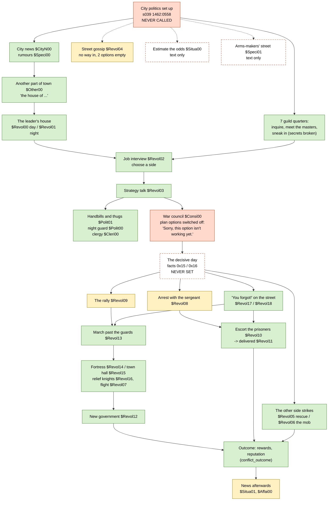

# The cut political campaign

Darklands ships with an almost complete storyline about city politics: a struggle between a
city's rulers and the people who want them gone, which the party can join on either side and
which ends in an arrest, a march on the town hall or the fortress, and a new (or a stronger)
government. Its 19 `$Revol` cards and a dozen helper cards are in the game, written and
coded. None of it ever happens, because the one routine that starts it is never called.

Darklands+ restores it as an experimental option, off by default: F12 > Settings > Helpers >
Cards and towns > **City politics** (`rules.politics`; port/mods/politics.c). This page charts
what the game has, what was broken or missing, and what Darklands+ wrote or put right. Both
sides were played through in Dortmund: the rumours, the job offers, the interviews, the
strategy talks, the war councils, the decisive days (the march on the Stadthaus and its street
battles, the arrests and the escort), the other side striking first, a day missed, the rewards.

## How it was meant to play

1. **Unrest.** Now and then a city has a political season (56 days). Its 15 interest groups
   (the seven guilds, the local merchants, the foreign traders, the Hansa, the Fuggers, the
   Medici, the church, the monastery, the cathedral) each lean towards the rulers or towards
   change, and one guild is where the agitators meet.
2. **Getting involved.** Rumours in the news ("an aristocrat is hiring people to put up
   notices", "someone with a grudge against the lord is hiring") lead to a house in another part
   of the city, or the agitators' guild master takes you to the leader. The leader interviews
   you and you sign on with the rebels or with the government, for pay or for the cause.
3. **The campaign.** Each day you post handbills and thugs from the other side come for you.
   In the guild quarters you sound out the masters, talk them round, dig up the guild leader's
   secret (a heretic, a traitor, a counterfeiter) and use it. You guard friendly houses at
   night and raid the other side's headquarters. The leader tells you how the groups stand.
4. **The decisive day.** When your side is strong enough, the war council sets a day three
   days off: the rebels march, or the guard arrests the ringleaders. The other side can strike
   first, and rumours in the streets warn of it.
5. **The end.** A rally, a march past the guards, a siege of the town hall or the fortress
   (knights may come to relieve it), or an escort of prisoners through an angry crowd. The
   city gets a new government or its ruler grows stronger; the party is rewarded or hunted,
   and travellers elsewhere talk about it afterwards.

## The chart

Green: written and coded, runs once reached. Yellow: written and coded, but nothing leads to
it. Red: switched off or never called. Dashed: text only, or not written at all.

## What exists

| Piece | State | Where |
|---|---|---|
| The political season of a city (15 groups, the agitators' guild, 56 days) | Coded, **never called** | s039 1462:0558 (0 callers in DARKLAND.EXE) |
| Group arithmetic: each group's side, the two sides' strength | Coded, used by the cards | s039 `loc_side_get/set`, `side1/2_strength`, `side1/2_percent` |
| Rumours in the news, the leader's house by day and by night | Coded, gated on the season | `$CityN00` 0x66, `$Speci00` 0x67, `$Other00` 0x7c, `$Revol00` 0x10, `$Revol01` 0x11 |
| Guild quarters: inquire, meet the masters, the leader's secret, sneak in | Coded, options hidden outside a season | `$Black00/01`, `$Sword00/01`, `$Armor00/01`, `$Bowye00/01`, `$Artif00/01`, `$cloth00/01`, `$jewel00/01` |
| The job interview, the strategy talk | Coded, run | `$Revol02` 0x74, `$Revol03` 0x79 |
| Handbills and thugs, guarding a house at night, swaying the clergy | Coded | `$Polit01` 0x37, `$Polit00` 0x6b, `$Cleri00` 0x6f |
| Street gossip ("government activities", "rebel activities") | Coded but nothing leads to it; those two options do nothing | `$Revol04` 0xbf |
| Estimating the revolt's odds | Text only | `$Situa00` |
| The arms-makers' street to the agitator's home | Text only | `$Speci01` |
| The war council | Text complete; code keeps only "get back to work" | `$Consi00` 0x70 (s072) |
| The decisive day ("the guard arrests today", "the rebels march today") | Read by 15 street cards, **written by nothing** | facts 0x15, 0x16 |
| Being at headquarters on the day: the arrest, the rally | Coded, nothing leads to them | `$Revol08` 0xb7, `$Revol09` 0xb8 |
| Meeting the day on the street, the other side striking | Coded, run (once the day is set) | `$Revol17` 0xbd, `$Revol18` 0xbe, `$Revol05` 0x80, `$Revol06` 0x7b |
| The escort, the march, the sieges, the relief, the flight, the victory | Coded, chained | `$Revol10`–`$Revol16`, `$Revol07` |
| Rewards and reputation at the end; the city marked | Coded | s039 `conflict_outcome` |
| News afterwards, here and in other cities | Texts and some code; wiring unverified | `$Situa01` texts 8–9, `$Affai00` texts 1–2 |

## Bugs found in the never-run code

- The season's own record doubles as the party's side (`loc_fact` queries also match kind-8
  events), and the setup fills it with the city's number instead of 0. The agitators' guild
  master therefore never offers the job (except in city 0).
- No guild leader is ever given a secret: the setup never fills fact 8 (only the cards clear
  it), so asking around never turns up one, sneaking into the leader's home ($Snuck00) never
  finds proof, and "reveal the leader's terrible secret" never appears.
- `$Snuck00` picks one of five ways to find the proof with `% 5` but handles 0, 1, 2, 4 and 5:
  the fourth never does anything, the fifth is never picked (and compares a roll with a member's
  number instead of the skill).
- `$Revol13` sets the bribe's option to "a saint can be called" (`opt_flag_1 = saints_usable()`,
  meant for the saint's option), so the bribe can be paid without the money. (`$Revol14` has
  the same kind of mistake with the rope, already corrected by the `cardopts` fix.)
- `$Revol02` text 7 and `$Revol18` show "$VarString1, the $VarString2" unfilled (the town hall or
  fortress name is not set before them).
- `$Revol03`'s report on the clergy reuses the merchants' attitude for the citizens and the
  Medici's for the bishop.
- `conflict_outcome` works out a chance of success from the two sides' strength and then
  throws it away.
- `$Cleri00` adds to the "fact" numbered by `party_x`, which the cards that lead to it leave at
  0 or 1, so a success can change the party's own side.
- Street cards: a night/day chance inside `if (side == -1) { if (side == 1) ... }` can never be
  used.
- The groups' sides are -1 for the rebels in every rule (strengths, the advice to march, the
  bribes' prices, the guilds swayed to the party's side), but the names table reads -1 as
  "oppose", so every report said the opposite of the facts.
- `$Revol03` offers the march only in a city with an imperial mint (`cur_loc_query(0x17)`; the
  town hall is 0x18), and tells the sides apart by `party_x`, the party's map position, which
  the cards use as a scratch variable.
- `$Artif00` was copied from the blacksmiths' card: it hides sneaking into the artisans' master's
  home when the blacksmiths are the agitators, and reports their attitude.
- The texts' `$VarString` and `$VarPhrase` tokens are not in the engine's list: they showed as
  written. `$Revol11` says "$CityLord Title" (a space in the token) and offers formulas and
  saints named by `$Text2` and `$Text3`, which nothing sets. `$Polit01`'s bribe shows a
  `$Money1` it never sets (it takes a tenth of the purse).
- `$Revol04` never sets option 0, shows four unwritten lines ("5" to "8") and does nothing for
  "government activities" and "rebel activities"; `$Revol09` shows lines "2" to "5"; `$Snuck00`
  a blank line whose handler is empty.
- `$Consi00` never shows its first text (the tally) and fills the option table with stubs.
- `$CityN00`'s "discuss the political situation here" goes to the general news, like "gossip
  about the situation"; the street gossip had no way in.
- "Eat your handbills" ($Polit01) never lets the party go: the thugs are still there.
- The guild cards mark "asked", "met the masters" and "sneaked in" once for the whole season,
  though the leader asks the party to report every day (through the agitators' guild).
- `conflict_outcome` marks the city overthrown (flag 0x80) whoever won, so the news afterwards
  always told of a new government; and it checks whether the party deserted (facts 0x24, 0x25)
  after clearing the season's facts.
- The guild leaders' names and `$Speci00`'s names are set only by the cards that lead there.
- Typos in the texts: "virutous", "the the guildsmen".

## What Darklands+ does

With the option ticked (port/mods/politics.c; nothing changes while it is off):

1. **Seasons.** On arriving in a city, if no season runs anywhere, one starts with a chance of
   1 in 6 (not in a city overthrown before, nor one whose rebellion was put down in the last 60
   days, nor one without a guild street). The setup is the game's own; then the party's side is
   set to 0, the agitators' guild is moved off the merchants (which have no guild card) and put
   on the side of change, and about one guild leader in three is given a secret.
2. **Every day** the guilds can be asked, met and visited again.
3. **The strategy talk** offers the march on the town hall (or the fortress, in a town without
   one) to the rebels and the arrests to the government's side, and `party_x` is set from the
   side.
4. **The war council** shows the tally (the same eleven groups the strengths count), lets the
   party review the plan (the new council or the exiled heir, as `$Revol02` chose) and put it
   into effect: the rebels march at Terce, the guard arrests at Lauds, three days later (facts
   0x16, 0x15, for twelve hours). A rebel speaks first, by the strength of the cause. If the
   other side has set its day, the leader says why not now.
5. **The other side strikes first** when the season is three weeks old and it is at least as
   strong, or five weeks old in any case: two days later, with the warnings in the gossip.
6. **On the day**, the leader's house starts the rally (`$Revol09`) or the arrest (`$Revol08`);
   joining in the street (`$Revol18`) starts with the rally too. A day the party missed is
   settled when it comes back (the side that acted wins by its strength), without reward or
   blame, and a notice says what happened.
7. **The gossip** (`$Revol04`), from the news and from the rumours of jobs, tells of the coming
   day ("within a day", "in the next few days") or names the leaders.
8. **Texts:** `$VarString` filled (the town hall's or the fortress's name, the exiled heir, a
   banner, the attitude), `$Support` the right way round, "the the" made "the", "$CityLord
   Title", the boon names, `$Polit01`'s bribe; the unwritten lines hidden.
9. **Tasks:** a town in a season reads "In turmoil" in the margin until the party takes a side;
   then the side, and its own side's day (the hour and the date), are tasks in the margin, the
   journal and on the map, with a banner for a picture.
10. **Afterwards:** a city whose government held is not marked overthrown and the news tells of
   the rebellion put down for 60 days.

Not done: `$Situa00` (estimating the odds) and `$Speci01` (the arms-makers' street) exist only as
text; the bugs in `$Snuck00`, `$Cleri00`, `$Revol03`'s clergy report and `conflict_outcome`'s
desertion check are left as they are.

## Testing

Test commands (port/runtime/testcmds.c): `upolit:` starts a season in the current city (option
or not); `upolitage:N` makes the season N days older (the other side then strikes at the next
street card). `ucall:29,0e76,2e74,-2,LOC,28,0,S,2,0` (`event_update`) sets the party's side S
(-1 rebels, 1 government); `uevents:28` lists the season's facts. `DL_POLITICS_LOG=1` logs what
the module does.

## Reference: the season's facts (tag 2, at the city)

| Fact | Meaning |
|---|---|
| 0 | The party's side: -1 rebels, 1 government, 0 none (the season record itself) |
| 1, 2 | The groups (bits) leaning to side -1, to side 1 |
| 3, 4, 5 | Per guild (bits): asked about politics, met the masters, tried to sneak in |
| 8 | Per guild (bits): its leader has a secret (never set: see the bugs) |
| 9, 0xa | Per guild (bits): the secret known, its proof found |
| 0x14 | Houses guarded at night |
| 0x17 | The agitators' guild (one bit) |
| 0x19, 0x1a | The two hiring rumours heard |
| 0x1b–0x22 | Visits to the leader's house (by day, by night; how they went) |
| 0x15, 0x16 | The guard arrests today / the rebels march today (never written) |
| 0x24, 0x25 | The government's strike / the rebels' march has taken place |
| 0x26 | A day of siege waited out |
| 0x23 | A random 0–99 (read by nothing) |

Group bits: 1 local merchants, 2 blacksmiths, 4 swordsmiths, 8 bowyers, 0x10 armourers, 0x20
artisans, 0x40 clothmakers, 0x80 jewellers, 0x400 and 0x800 the city church and the monastery,
0x1000 foreign traders, 0x2000 the Hansa, 0x4000 the Fuggers, 0x8000 the Medici, 0x200 (no card
names it consistently: the people or the cathedral).
